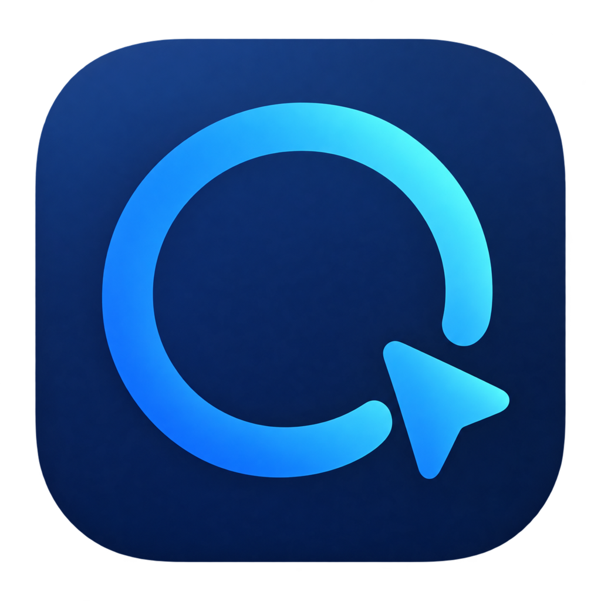
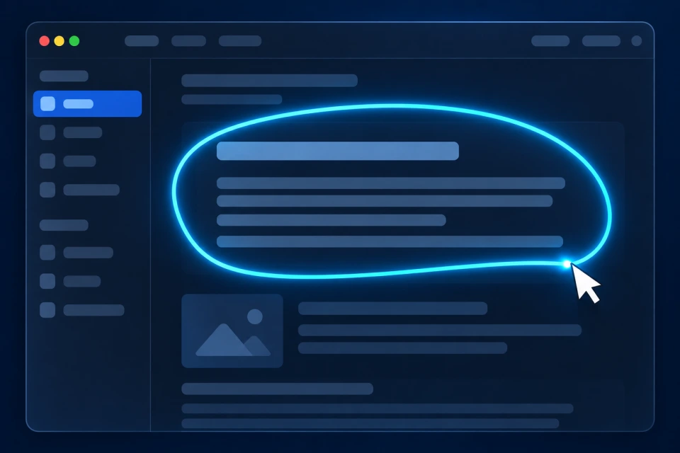

  

# 圈助 CircleAssist

**圈一下，说出需求，接着做事。**

圈选眼前的内容处理，把说的话写进输入框，也能用语音或文字发起任务。圈助面向 Apple Silicon Mac，语音识别在本机运行，AI 模型由你选择。

[English](README.md) · [下载 Mac 版](https://quanzhu.fangtangtech.com/zh-Hans#download) · [官网](https://quanzhu.fangtangtech.com/zh-Hans) · [问题反馈](https://github.com/zipshuo-cloud/circleassist/issues/new/choose)

Apple 芯片（M1 及后续型号）· macOS 26 及以上

*圈选流程示意图。*

## 圈选内容再提问

圈选屏幕上的内容，翻译、解释或整理；结果可以复制，也可以在对话中继续追问。

## 把话说进输入框

在已聚焦、可编辑的输入框中启动语音输入。可选的 AI 优化用于整理识别文字，再继续写作。

## 直接交代任务

用说话或打字发起网页查询、提醒事项、支持的应用控制和桌面操作；任务执行时通过 HUD 查看进展。

剪贴板历史、知识收藏、记忆管理和 MCP 工具连接用于承接更长的工作流程。

## 首次使用

1. **登录圈助。** 下载安装后，按欢迎指引使用邮箱验证码登录或注册，并确认使用权益。
2. **配置语音。** 下载约 539 MB 的本地语音识别模型。
3. **选择 AI。** 配置兼容的云端模型服务，或选择受支持的本地模型。

使用相关功能时，再按提示授予所需的 macOS 权限。建议使用 16 GB 及以上内存；8 GB 设备尚未充分验证。本地 AI 模型的内存需求取决于所选模型。

## 模型与费用

语音模型安装后，在本机完成语音识别。AI 任务使用你配置的模型；第三方云模型费用与软件活动权益分开计算，桌面任务可能调用多次模型。

启用主动建议后，符合条件的提醒也可能在后台请求模型；可以在设置中关闭主动建议。

当前活动与使用权益以[官网](https://quanzhu.fangtangtech.com/zh-Hans)为准。配置和使用问题见[常见问题](docs/FAQ.zh-Hans.md)。

## 隐私与兼容范围

使用云端 AI 时，任务文字和相关图片会发送给所选服务商。语音输入启用云端 AI 优化时，本次识别文字也会发送给该服务商。

屏幕读取和桌面操作需要相应系统权限。输入框和桌面操作的兼容性取决于目标应用，图像任务需要支持图像的模型。账号服务、首次下载、网页查询和云端 AI 需要联网。

[隐私说明](https://quanzhu.fangtangtech.com/zh-Hans/privacy) · [使用条款](https://quanzhu.fangtangtech.com/zh-Hans/terms) · [联系支持](https://quanzhu.fangtangtech.com/zh-Hans/support)

## 问题反馈

[提交 Bug 或功能建议](https://github.com/zipshuo-cloud/circleassist/issues/new/choose)，请附应用版本、macOS 版本和复现步骤。截图前移除个人信息，不要公开 API Key、验证码或私人对话。

私人支持问题请联系 [support@fangtangtech.com](mailto:support@fangtangtech.com)。

本仓库用于产品说明、版本下载和反馈，不包含应用源码。GitHub 自动生成的 **Source code（zip / tar.gz）** 只包含本仓库的产品说明、图片和反馈模板；安装应用请选择 **DMG**。参见[仓库使用说明](REPOSITORY_USAGE.md)。
